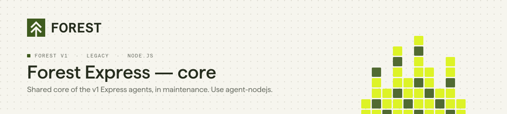

<p align="center">
  <picture>
    <source media="(prefers-color-scheme: dark)" srcset="./assets/header-forest-express-dark.svg">
    
  </picture>
</p>

<p align="center">
  <a href="https://www.npmjs.com/package/forest-express"></a>
  <a href="https://github.com/ForestAdmin/forest-express/actions/workflows/build.yml"></a>
  <a href="./LICENSE"></a>
</p>

> [!IMPORTANT]
> **This is the shared core of the Forest v1 Express agents, in maintenance mode.** It receives fixes but no new features.
> **Starting a new project?** Use [agent-nodejs](https://github.com/ForestAdmin/agent-nodejs), the current Node.js agent.
> **Already on a v1 Express agent?** Follow the [v1 to v2 migration guide](https://docs.forest.app/guides/migration/from-v1/overview).

## You probably don't need to install this package

`forest-express` is not used on its own. It holds the routes, authentication, permissions and serialization shared by the two v1 Express agents, which depend on it:

| Your ORM | Install |
|---|---|
| Sequelize (SQL) | [forest-express-sequelize](https://github.com/ForestAdmin/forest-express-sequelize) |
| Mongoose (MongoDB) | [forest-express-mongoose](https://github.com/ForestAdmin/forest-express-mongoose) |

Setup instructions are in the README of each one.

## Requirements

| | |
|---|---|
| Node.js | `>= 16` (CI runs on 24) |

## Documentation

| | |
|---|---|
| Install a v1 Express agent | https://docs.forest.app/legacy/javascript-agents/how-tos/setup/install |
| v1 reference guide | https://docs.forest.app/legacy/javascript-agents/reference-guide/models/overview |
| Agents overview | https://docs.forest.app/legacy/agents-overview |
| Migrating to v2 | https://docs.forest.app/guides/migration/from-v1/overview |

## Contributing

Bug fixes are welcome; new features go to [agent-nodejs](https://github.com/ForestAdmin/agent-nodejs). See [CONTRIBUTING.md](./CONTRIBUTING.md) for setup, tests and commit conventions.

```bash
yarn install --frozen-lockfile && yarn build && yarn test
```

## License

Apache 2.0. See [LICENSE](./LICENSE).
